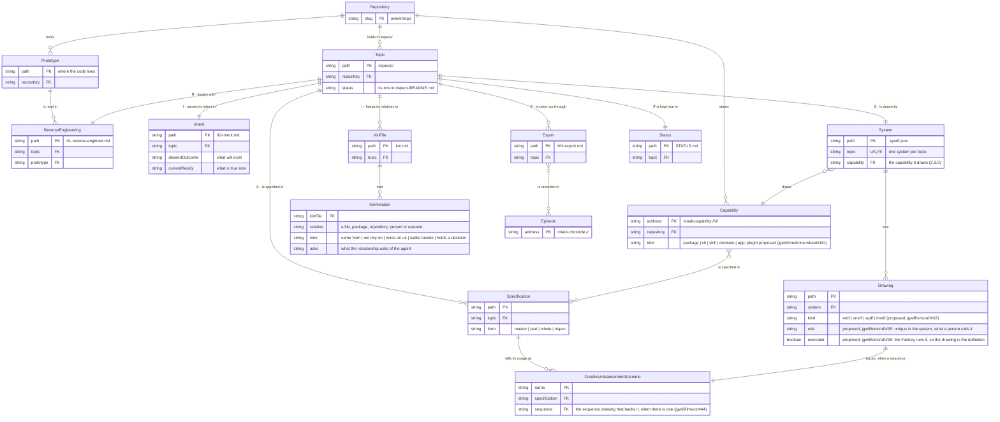

# rise-framework

The RISE framework drawn as a model. Its specification is the framework text, [`llms-rise-framework.txt`](../../llms-rise-framework.txt) (2.3.0). This folder holds its drawings, as the section *Toward 3.0: Model-Driven Specification* asks of a new specification. A person and an agent discuss the framework on this drawing, and an agent navigates it to see how the parts of RISE relate.

| File | What it holds |
|---|---|
| `rise-framework.sysdf.json` | the system: the drawings that belong together |
| `rise-framework.erdf.json` | the ERD: 15 entities the text names and 18 relationships, from a repository and its topics to the system, its drawings and the capability a system draws |
| `rise-framework.erd.mmd` | the ERD rendered by the loom as Mermaid (`render_diagram`, format `mermaid`) |
| `rise-framework.kin.md` | its relatives, and what each relationship asks of us |

Attributes marked *proposed* in the ERD are not in the RISE text yet: `Drawing.role` and `Drawing.executed` (jgwill/smcraft#35), the decision-model kind (jgwill/smcraft#32), the `plugin` capability kind (jgwill/medicine-wheel#181).

**Open it on the canvas:** `set_project_file` on `rise-framework.sysdf.json` with the stateloom MCP, then `show`. **Check it:** `check_system` (0 errors, 0 warnings on 2026-11-26). **Render it again** after a change to the ERD: `render_diagram` with format `mermaid`, then replace the block below.

**Status:** drawn 2026-11-26 from the text at 2.3.0, discussed on jgwill/llms-txt#49. A change to the text's entities is a change to this drawing, made in the Return.
